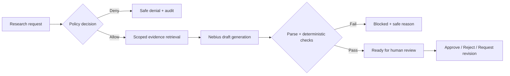

# MatterGate build plan

Based on `mattergate-prd.md`, version 1.0. Updated October 24, 2026. The local fixture MVP and independently implemented Nebius transport are implemented. The operator has now confirmed the live draft passing all ten controls, human approval with REVIEW_SUBMITTED, and the restricted-request denial. The Evidence & Review upgrade is implemented locally with 101 passing automated tests, 32 browser screen/viewport checks and source test-build packaging. Repeat live testing, remote CI, public access/video and submission execution remain outstanding.

## Implementation status

| Phase | Status and evidence |
|---|---|
| 0. Reusable controls | Implemented: adapted policy evaluator, citation checks, retrieval SQL, fixture/review portions, modification notices, licenses, and a pinned source/hash manifest. |
| 1. Foundation | Implemented: typed contracts, fixed transitions, SQLite schema, idempotent seed command, sessions, audit chaining and transactional appends. |
| 2. Denial and retrieval | Implemented and tested: denial before retrieval/provider invocation, explicit source scopes, source hash checks, dimensions, expiry and context budgets. |
| 3. Fixture workflow | Implemented: valid brief, ten checks (the eight PRD checks plus schema and claim coverage), and all three human review outcomes. |
| 4. Nebius transport | Operator-run Lightning inference using statement-owned citations reached Ready for review with 10/10 checks, then Approved and REVIEW_SUBMITTED. Current automated tests still need rerunning after the later edits. |
| 5. Demo interface | Implemented all seven screens. Desktop browser walkthrough verified the allowed brief, explicit Alex review, and non-revealing denial. Responsive CSS is included; a dedicated mobile-browser pass remains open. |
| 6. Verification and packaging | Initial automated baseline: 73 passed before later edits. Current README, source attribution, API/user/setup/operations/testing guides, screenshots, publication guide and submission draft are prepared. Official rules were checked October 24. Local 0.2.0 suite: 101 passed. Fixture browser flow and four viewport widths verified. Remote CI, native zoom/mobile-device checks, video and judge-access URL remain open. |

Run instructions and current limitations are in [README.md](README.md). Preview/test data are synthetic. This status does not assert that the PRD's full live-demo definition of done is complete.

## What we are building

MatterGate is a demo web application for permissioned legal/privacy research. A requester submits a question tied to a matter, purpose, and jurisdiction. The server decides which sources may be used before retrieving evidence or calling an NVIDIA model through Nebius. The resulting draft must pass deterministic controls before a human reviewer can approve, reject, or request revision.

The central product experience is an inspectable workflow:

Every stage records safe audit events. Model output cannot grant permission or approval.

## PriviLAB reuse decision

**PriviLAB is included through selected, attributed source adaptations in the running control layer.** This changes the original plan from architectural inspiration to code reuse. The full upstream application is not installed or forked. See [the source assessment](docs/privilab-reuse.md) for inspected files, compatibility gaps, and evidence.

Pin adaptations to upstream commit [`21baa4ccdc468bd6a30681344eb8ec3df752790a`](https://github.com/DataStrategyLab/privilab/tree/21baa4ccdc468bd6a30681344eb8ec3df752790a). Keep the adapted permission and citation logic in `app/integrations/privilab/`, with the SQL adaptation in MatterGate's retrieval repository. MatterGate services must invoke these modules in both live and fixture runs; attribution alone is not integration.

| Upstream component | Planned reuse | MatterGate additions |
|---|---|---|
| Strict policy parser and permission evaluator | Adapt parser validation, explicit-block precedence, missing-context handling, and effective-allow gate. | Canonical actor/purpose/jurisdiction selectors, PRD decision/reason mapping, scope source IDs and expiry. |
| Scoped FTS5 retrieval SQL | Adapt authorization-first query structure, parameter binding, and deterministic ranking/tie-breaks. | Explicit source-ID intersection, chunk eligibility metadata, five-chunk/8,000-character limits. |
| Provenance index and source/chunk citation checks | Adapt exact identifier-pair validation and safe reason codes. | Structured multi-section brief, claim coverage, disclaimer, restricted-source, injection, and review-state checks. |
| Boundary tests | Port relevant policy, source isolation, citation, and duplicate-review cases to our contracts. | Jordan/Maya/Alex scenarios, jurisdiction/purpose isolation, provider spies, and MatterGate HTTP/state checks. |
| Review and fixture controls | Adapt small eligibility/conflict and fixture-hash-validation portions where they fit. | Server session identity, rationale rules, review only from `READY_FOR_REVIEW`, our own fixture payload and manifest. |

The upstream preview disables its default live OpenAI client and documents native setup and Docker qualification holds. We inspected source only. Its live transport, bootstrap, Docker image, dependency lockfile, branded UI, domain corpus, and complete provenance store are excluded from reuse. Build and validate MatterGate's Nebius transport independently; changing the upstream base URL or removing its live restriction is not the integration strategy.

Upstream Apache-2.0 license and applicable notices are preserved under `third_party/privilab/`, modified files carry notices, and `docs/upstream/privilab-manifest.json` records symbols, source hashes, local destinations and changes. Both provider modes use the adapted permission/retrieval/citation control path.

## User-facing scope

| Screen | What the user can do |
|---|---|
| Scenario picker `/` | Launch the allowed vendor assessment or blocked privileged request; see the demo disclosure and provider/mode badge. |
| New run `/runs/new` | Choose a seeded requester, matter, jurisdiction, purpose, question, and available model mode. |
| Run progress `/runs/{id}` | Follow timestamped policy, retrieval, drafting, evaluation, and review stages. |
| Brief `/runs/{id}/brief` | Inspect the scope, summary, conditions, caveats, open questions, cited evidence, and every control result. |
| Review `/runs/{id}/review` | As Alex, approve, reject, or request revision; enter a rationale where required. |
| Audit `/runs/{id}/audit` | Inspect ordered safe events, evidence IDs, provider metadata, and review decisions. |
| Status `/status` | See database readiness, corpus version, configured model, and live/fixture availability. |

The progress, brief, review, and audit screens will share one run workspace with consistent navigation. Denied and blocked runs display a safe explanation without rendering a generated answer.

Three demonstrations must work:

1. **Allowed vendor assessment:** Jordan asks about sharing EU customer contact data with Vendor X. The app selects permitted evidence, produces a cited draft, passes controls, and awaits Alex's decision.
2. **Blocked privileged request:** Jordan requests restricted M&A research. The app denies the request with zero retrieval calls, zero evidence rows, and zero provider calls.
3. **Untrusted source instruction:** An authorized test excerpt contains an instruction to bypass controls. It remains source data; tests demonstrate that it cannot alter scope or review state, and that the known prohibited output is blocked.

## Proposed technical choices

These are implementation defaults, not additional PRD requirements.

| Area | Choice | Reason |
|---|---|---|
| Backend | Python + FastAPI + Pydantic | Typed request/draft contracts and independently testable services. |
| UI | Jinja templates, CSS, minimal JavaScript | Supports all required screens without a separate frontend service. |
| Persistence | SQLite, FTS5, small explicit repository layer | Local setup, constrained search, and clear transaction boundaries. |
| Progress | Background run execution with status polling | The run page can show actual provider progress instead of waiting for one long response. |
| Provider | Separate Nebius and deterministic fixture adapters | Same controls apply in both modes; fixture mode is visibly labeled. |
| Tests | pytest, temporary databases, provider/retrieval spies | Proves both expected results and operations that must never occur. |
| Demo identity | Server-managed seeded identity session | Review authorization derives from server session identity, not a posted actor ID alone. |
| Reused controls | Pinned PriviLAB source adaptations with ported tests | Reuses implemented permission/citation boundaries without importing the upstream runtime or domain assumptions. |

Use the existing workspace. Create the application structure at its root; do not add a redundant nested project directory.

The database will hold users, policies, sources, source chunks and their FTS index, research runs, selected evidence, evaluation results, review decisions, and audit events. Persist scope snapshots, policy/prompt/corpus versions, and actual provider mode for reproducibility.

## Build sequence and completion gates

### 0. Extract and verify the reusable controls

- Create `docs/upstream/privilab-manifest.json` with the inspected commit, upstream paths/symbols, content hashes, local destination, and modification summary for each copied portion.
- Include upstream license and applicable NOTICE attribution under `third_party/privilab/`; add modification notices to adapted source files and a README attribution to Data Strategy Lab, including the upstream creator credit.
- Adapt the permission parser/evaluator and citation primitives into `app/integrations/privilab/`. Keep imports local and avoid importing upstream package initializers or pulling its application dependency graph into MatterGate.
- Extend the policy selectors explicitly for purpose and jurisdiction. Keep public request/scope/draft contracts owned by MatterGate; do not deserialize an upstream scope from client input.
- Port the relevant fail-closed and citation tests before wiring the modules into services. Record which behavior is preserved and which intentionally differs from upstream.
- Do not execute upstream bootstrap, install the PriviLAB package, run its Dockerfile, enable its disabled SDK, or claim upstream tests have passed locally. Reassess any later upstream update explicitly.

**Completion gate:** The selected controls have traceable source attribution and passing adapted tests. Missing context, explicit block, unresolved conditions, unknown citations, and mismatched source/chunk pairs all stop protected progression.

### 1. Foundation and persistent workflow

- Add dependency configuration, `.gitignore`, `.env.example`, setup instructions, and test configuration.
- Implement typed requests, access scopes, draft contracts, and a single validated state-transition map.
- Create SQLite schema, seed/reset commands, repositories, and transactional audit appends with hash verification.
- Seed Jordan, Maya, and Alex; the policy matrix; and six synthetic/public source records with chunk metadata and hashes.
- Add server-managed demo identity handling and session checks for protected mutations.

**Completion gate:** A clean database seeds reproducibly; invalid transitions fail; audit tampering is detectable. No real confidential material or credentials are seeded.

### 2. Denial path and scoped retrieval

- Wire the adapted PriviLAB permission evaluator into policy resolution from requester, matter, purpose, and jurisdiction. Map upstream `BLOCK` and `UNKNOWN` to safe denial codes; unresolved conditional access cannot progress in the MVP.
- Require a valid, unexpired allowing scope at retrieval and provider boundaries.
- Store the exact allowed source IDs before retrieval begins.
- Adapt PriviLAB's authorization-first FTS query to intersect explicit allowed source IDs with eligible chunk metadata before selecting results. Retain stable ranking tie-breaks, at most five chunks, and an 8,000-character context budget. Port the isolation tests, including restricted matches not changing authorized result ordering.
- Persist selected evidence and expose only authorized run details through the API.

**Completion gate:** The denied scenario stops before retrieval/provider invocation. The allowed scenario never selects restricted M&A material. Empty evidence blocks drafting.

### 3. Complete the allowed workflow with a fixture

- Implement a deterministic fixture for the seeded vendor question and compatible evidence only. Adapt PriviLAB's fixture-byte/hash validation for our own manifest and payload; reject unsupported fixture requests explicitly.
- Implement the versioned server prompt and untrusted evidence envelope.
- Strictly parse draft JSON: reject duplicate/unexpected fields, validate recommendation enum, bounded lengths, 1–5 citations, exact disclaimer, and maximum serialized size. The upstream `answer_text` contract does not replace the PRD's brief schema.
- Wire the adapted PriviLAB citation/provenance identifier checks into the evaluator; implement the remaining required rules so all eight PRD checks and their pass/fail reasons are persisted. A correctly stopped permission-denied run must never become a passing answer gate.
- Adapt the useful review eligibility/conflict checks, then enforce reviewer session identity, rationale validation, `READY_FOR_REVIEW` for every action, and atomic decision/audit writes. Do not inherit upstream's fixed reviewer identity or its allowance for negative reviews on generated blocked drafts.

**Completion gate:** The seeded fixture run reaches `READY_FOR_REVIEW`; only Alex can move it to a review outcome. Bad drafts block, and failed audit writes cannot leave an approved result.

### 4. Add live Nebius inference

- Verify the current official Nebius endpoint, available NVIDIA model identifier, and structured-output support before implementing the adapter.
- Read credentials and provider settings from environment configuration; expose only safe status metadata.
- Enforce the 45-second total generation budget, 900 output-token limit, bounded context, and configured temperature.
- Capture actual provider/model identity, latency, and a provider request ID when available.
- Permit at most one JSON-repair attempt within the same total deadline; otherwise block malformed output. Log attempts safely.
- On provider failure, show `MODEL_UNAVAILABLE`. Offer an explicit new fixture run for the supported seeded scenario; never silently relabel a failed live call as successful inference.

**Completion gate:** A real Nebius request produces a valid reviewable draft. Missing credentials, malformed output, and provider failure each have an honest, safe UI state.

### 5. Build the demo interface

- Implement all seven routes with a shared run workspace.
- Add the two scenario cards, validated custom form, timestamped progress, and clear live/fixture badges.
- Connect each displayed material claim to selectable evidence citations, including source/chunk IDs, authority tier, classification, and excerpts.
- Show every deterministic check and keep human review state visually separate from the model's recommendation.
- Add safe denial/failure views, keyboard support, text labels alongside status colors, and ARIA live progress updates.
- Escape source/model text, add request-rate limits, and protect session-backed mutations against CSRF.

**Completion gate:** A user can run, inspect, and review the seeded scenario entirely through the UI. The denial screen and ledger make the absence of a provider call understandable.

### 6. Verify and package the demonstration

- Run the PRD's mandatory unit and integration tests, including scope violations, missing disclosure, injection fixtures, unauthorized reviews, and audit failures.
- Test duplicate/concurrent review submissions: one decision succeeds, subsequent attempts receive a conflict.
- Test status/read access, expired scopes, HTML escaping, mode labels, and custom-run fixture restrictions.
- Verify that both provider modes execute the adapted PriviLAB controls. Check the source manifest, copied-file license/notice coverage, and all intentional behavior differences against the source assessment.
- Rehearse from a clean database in fixture mode and with live credentials. Measure policy/retrieval latency against the PRD targets.
- Finish README setup, architecture, corpus provenance, known limitations, and a roughly three-minute demo script.
- Recheck official hackathon rules and required attribution before any submission. Deployment, recording, and publication remain separate execution steps.

**Completion gate:** All mandatory tests pass, the allowed and denied flows reproduce from documented steps, and live provider use is demonstrated rather than inferred from a configured model name.

## Specification gaps to resolve using these defaults

| Gap | Proposed resolution |
|---|---|
| The denied example selects vendor onboarding but asks about a merger. | Seed the blocked scenario with `restricted_m_and_a`. Also test the same text under vendor onboarding: it must never expand scope or answer using restricted evidence. Keyword matching is not an authorization mechanism. |
| A posted `actor_id` can impersonate Alex despite a role check. | Derive the acting identity from a server-managed session and reject mismatched identity fields. An explicit demo identity switch remains a simulation, not production authentication. |
| Progress requires an immediately available run ID, while the example POST returns a completed run. | Proposed API refinement: return HTTP 202 with run/status URLs, then poll `GET /api/runs/{id}`. Keep the final result fields in that status response. Use one process for the MVP; mark interrupted active runs safely on restart. |
| `CONTEXT_ASSEMBLED` appears in the timeline but not the state enum. | Keep it as a timestamped audit/progress event between retrieval and drafting, rather than inventing a separate persisted status. |
| Fixture fallback is described both as automatic and explicit. | Use explicit fixture selection. Failed live runs retain their failure state; a fixture retry creates a separately labeled run. |
| Citation existence does not establish that every sentence is supported. | Require displayed substantive statements to map to the draft's cited claims, with exact normalized-text coverage or a small claim-ID contract refinement. Block uncovered assertions. These checks establish citation linkage, not legal accuracy or semantic entailment; human review remains necessary. |
| An instruction-detection event cannot prove general injection resistance. | Record that untrusted instruction-like text was detected and that specific controls passed. Demonstrate the known test attack without claiming protection against all prompt injection. |
| Source purposes use descriptive labels while requests use enums. | Normalize seed metadata to canonical purpose/jurisdiction values. Explicitly deny unsupported actor/matter/purpose combinations, even when the form lists those values. |
| The source injection contains `SYSTEM:` despite evidence-envelope guidance against role labels. | Preserve it as escaped test-source data inside the fixed envelope; never turn it into a provider message role or executable template syntax. |
| PriviLAB's scope, result, review, and storage contracts differ from this PRD. | Reuse selected source logic behind MatterGate-owned contracts. Extend purpose/jurisdiction and scope validity; retain our full brief, reviewer session/rationale rules, persistent run view, and event hash chain. |

## Scope boundaries and remaining dependencies

The MVP excludes file uploads, arbitrary URL ingestion, live web research, vector search, SSO, production policy administration, real client data, and autonomous approval. Request revision records the review outcome and rationale; an editing/regeneration loop is future work.

Live credentials and model availability were confirmed through user-run inference on October 24, 2026. The active default is `nvidia/Nemotron-3_5-Lightning` on Nebius's global endpoint, with thinking disabled. The operator confirmed a live brief passing every control and subsequent human approval. The public-reference provenance is in `docs/corpus.md`; the checked submission requirements and open assets are in `docs/hackathon-submission.md`.

The initial commit was published to GitHub. The later Evidence & Review working tree has current local test and browser evidence; see docs/testing.md and docs/release-guide.md. Next: test live together, review and publish the upgrade revision, inspect CI, provide the actual judge-access URL, record the video and complete the form. The source archive is local only. No deployment or form submission has occurred.
