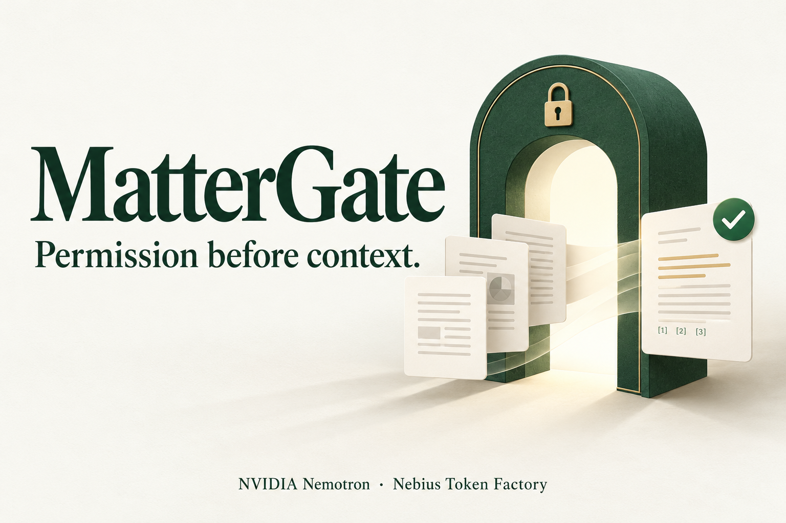
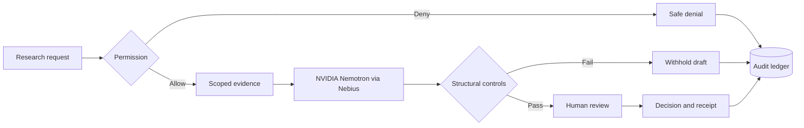
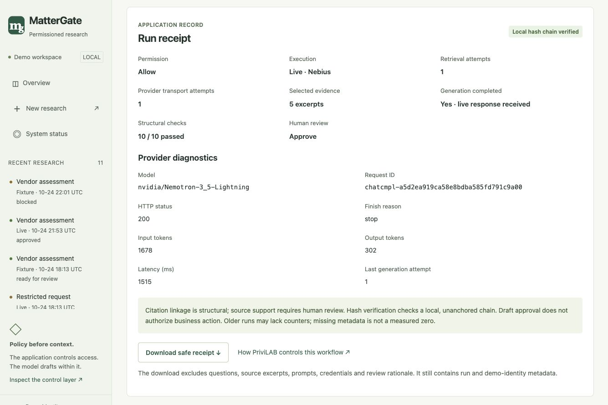

# MatterGate

**Permission before context. Research with evidence. Human review.**



MatterGate is a legal/privacy research demonstration that checks who may use
which evidence **before** retrieval or AI inference. NVIDIA Nemotron on **Nebius
Token Factory** drafts a cited assessment; application code validates it, and a
separate human reviewer records the decision.

[Live demo](https://mattergate-34-225-81-63.sslip.io) ·
[Try locally](#try-locally-no-api-key-needed) ·
[Visual testing guide](docs/team-testing-guide.md) ·
[Architecture](docs/architecture.md) · [Gallery](docs/images/devpost/README.md) ·
[Handover](HANDOVER.md)

> Uses synthetic internal documents and an attributed public reference. Demo
> identities are freely selectable. This is not legal advice, production
> authentication or a compliance certification.

The [hosted AWS demo](docs/hosting.md) gives each browser session its own workspace.
Use the same browser for the request and review. Live generation uses a shared
allowance; fixture mode is an explicit alternative. Hosting and public-mode
controls were verified on October 30, 2026.

## Try locally - no API key needed

Use Python 3.14 for the environment verified locally and in CI. The project
requires Python 3.12+ and SQLite FTS5; the entire version/platform range has not
been qualified. No frontend build is required.

In a **new checkout**:

```sh
git clone https://github.com/NaveenGali11/MatterGate.git
cd MatterGate
python3 -m venv .venv
.venv/bin/python -m pip install -r requirements.lock -e .
cp .env.example .env
.venv/bin/python -m uvicorn app.main:app --host 127.0.0.1 --port 8000
```

Open [http://127.0.0.1:8000](http://127.0.0.1:8000). Startup seeds the local database.
Use one worker and keep the server terminal open. Preserve any existing `.env`
instead of overwriting it. The commands above use macOS/Linux venv paths.

1. Open **New research** as **Jordan**. Keep the prefilled EU Vendor X question,
   matter and purpose unchanged, and select **Fixture**.
2. Choose **Check scope and research**. Open the brief and select a numbered
   reference to inspect its authorized excerpt.
3. Open **Human review**, choose **Continue as Alex**, and record a decision after
   inspecting the assessment.
4. Open **Run receipt** to inspect the decision, audit and downloadable JSON.
5. Return to Overview and choose **See the blocked request**. Permission denial
   should stop the new run before retrieval or provider invocation.

Fixture mode uses a saved, hash-checked response for the exact seeded question.
It makes no Nebius call. Arbitrary questions require live mode and remain subject
to the application policy. Full configuration, stable private session secrets and
an alternative uv installation are in [setup](docs/setup.md).

The [5-10 minute visual guide](docs/team-testing-guide.md) includes screenshots,
expected outcomes, negative cases and a bug-report template.

## What happens inside

| Responsibility | Owner | Result |
|---|---|---|
| Research permission | Application policy | An expiring scope limits eligible evidence |
| Research draft | NVIDIA Nemotron via Nebius, or explicit fixture | Summary, conditions, caveats and evidence references |
| Structural validation | Application code | Ten checks must pass before human review |
| Draft disposition | Human reviewer | Approve, reject or request revision, with an audit record |

Approving a draft accepts the **research assessment**. It does not authorize the
underlying data sharing. An approved assessment may recommend **do not proceed**.
Request revision records feedback; it does not automatically regenerate a draft.



The stack is **FastAPI, Pydantic, Jinja, minimal JavaScript, HTTPX and SQLite/FTS5**.
Retrieval selects at most five authorized chunks and 8,000 context characters.
The model has no tools to expand scope or approve its own output.

## See the product


*Actual live run with synthetic/public evidence. The thumbnail is AI-generated
promotional artwork; the gallery contains real product captures.*



The [gallery](docs/images/devpost/README.md) also shows human review, Overview and
an older denied request. Screenshot metadata describes those recorded runs;
new run IDs, answers, token counts and latency can differ.

## Enable live NVIDIA inference

Set these server-side values in your private `.env`, then restart:

```dotenv
NEBIUS_API_KEY=your_private_key
NEBIUS_BASE_URL=https://api.tokenfactory.nebius.com/v1
NEBIUS_MODEL=nvidia/Nemotron-3_5-Lightning
```

Keep credentials out of Git and browser code. A configured badge enables live
attempts; inspect a completed run to verify actual inference.

The adapter uses a restricted HTTPS host allowlist, normal TLS verification, no
redirects or environment proxies, a total deadline of 45 seconds and a maximum
900-token output budget. It requests thinking off for recognized model identifiers.
At most one regeneration attempt is allowed for malformed output within that
same deadline. Failed live runs stay failed; a fixture demo is a separate run.

Statements own their evidence IDs in the response contract. The app displays the
same statement text and verifies exact references; it does not invent citations
or use fuzzy matching to force a pass. See [API](docs/api.md) and
[operations](docs/operations.md) for contracts and failure codes.

The web server runs locally; live inference runs on Nebius. No hosted application
URL or Nebius compute deployment is supplied by this repository.

## Verification

- **101 automated tests** passed again on October 28 during public-source cleanup.
  Packaging, local documentation links, attribution hashes and archive integrity
  also passed; see [testing](docs/testing.md).
- Isolated browser QA completed the fixture, evidence, review, receipt and denial
  flow, plus 32 route/viewport checks.
- The operator confirmed live run `08126a78` with 10/10 structural checks, human
  approval, one provider attempt, 302 output tokens and 1,515 ms provider latency.
  This is one observed run, not a benchmark.
- [GitHub Actions passed for `552a5fa`](https://github.com/NaveenGali11/MatterGate/actions/runs/40139797857).
  Check the workflow for any later commit separately.

Run fixture/mock tests without paid inference:

```sh
.venv/bin/python -m pytest
.venv/bin/python scripts/check_release.py
```

## PriviLAB reuse and licenses

MatterGate adapts selected source from
[DataStrategyLab/privilab at `21baa4c`](https://github.com/DataStrategyLab/privilab/tree/21baa4ccdc468bd6a30681344eb8ec3df752790a):
permission parsing/evaluation, authorization-first retrieval, exact citation checks,
and selected fixture, review and boundary-test logic.

These are executed local adaptations, not a PriviLAB API connection or full
upstream installation. Credit **Data Strategy Lab LLC** and upstream Creator &
Lead Architect **Andrew Tsintsiruk**. No affiliation or endorsement is implied.

Original MatterGate source is [MIT licensed](LICENSE). Adapted PriviLAB portions
retain their [Apache-2.0 license](third_party/privilab/LICENSE) and
[notices](third_party/privilab/NOTICE). The [reuse assessment](docs/privilab-reuse.md)
and [source/hash manifest](docs/upstream/privilab-manifest.json) document the changes.

## Limits and further reading

Citation linkage does not prove factual or legal correctness. Known attack-string
checks are not universal prompt-injection protection. The audit hash chain is
local and unanchored; it is not administrator-proof. Runs use one-process
background tasks rather than a durable queue. This demo has no uploads, arbitrary
web ingestion, SSO or production policy administration.

[Documentation index](docs/README.md) · [Current PRD](mattergate-prd.md) ·
[Roadmap](BUILD_PLAN.md) · [Threat model](docs/threat-model.md) ·
[Security](SECURITY.md) · [Contributing](CONTRIBUTING.md) ·
[Changelog](CHANGELOG.md) · [Release guide](docs/release-guide.md) ·
[Hackathon overview](docs/hackathon-submission.md)
