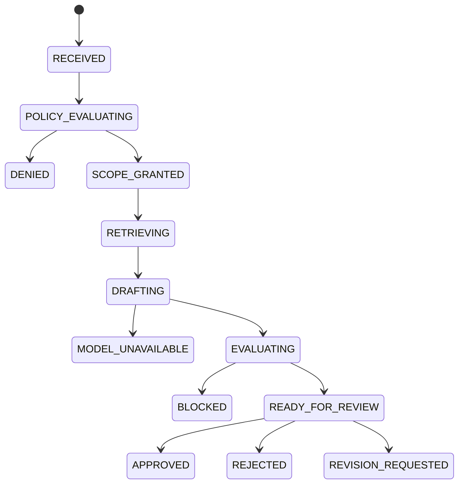

# MatterGate implementation

The app is a local FastAPI/Jinja modular monolith, backed by SQLite/FTS5. It uses
one worker with threadpool background tasks, signed demo sessions and same-origin
JSON APIs. No hosted service or distributed job runner is configured.

| Module | Responsibility |
|---|---|
| `app/main.py` | Routes, signed identity/session matching, CSRF, limits, safe response projection and page rendering. |
| `app/domain.py` | PRD-owned requests, explicit access scopes, draft schema, strict parsing and validated transition map. |
| `app/integrations/privilab/` | Adapted strict policy engine and exact citation identifier checks. |
| `app/services/policy.py` | Metadata-only policy resolution and source-ID snapshot before retrieval. |
| `app/services/retrieval.py` | Adapted authorization-first FTS query, metadata/hash verification, ranking and evidence budgets. |
| `app/services/runs.py` | Persisted orchestration, safe stop behavior, evaluation gate and read authorization. |
| `app/services/evaluation.py` | Ten deterministic checks, including the eight required by the PRD. |
| `app/services/review.py` | Alex-only, ready-state review with required rationale and conflict handling. |
| `app/providers/` | Hash-verified fixture and independently authored Nebius chat-completions transport/prompt. |
| `app/persistence/` | Schema, SQL repositories, transactions and append-only audit hash chain. |
| `app/seed/` | Original synthetic corpus, policy and fixture manifests. |

## Execution

`POST /api/runs` checks session identity, input, mode configuration and rate limits,
then atomically persists RECEIVED and RUN_CREATED. It returns HTTP 202 and status,
brief and audit URLs. Background execution progresses through policy, scope,
retrieval, drafting and evaluation. `GET /api/runs/{id}` exposes safe current state
to the original requester or Alex. Polling updates the run workspace.

A denied run stores no selected evidence and clears its persisted question text.
No retrieval or provider method is called. A granted run stores explicit allowed
source IDs before reading text. Retrieved chunk IDs are persisted separately.
`CONTEXT_ASSEMBLED` is an event, not an additional persisted status.

Both providers require a valid allowing scope matching the request and bounded,
authorized evidence. Fixture invocation has distinct FIXTURE events; it never
creates MODEL_REQUESTED/MODEL_COMPLETED events. Live inference uses the same
controls. Its asynchronous HTTP transport is invoked inside a synchronous worker
with one cancellable total timeout covering connection, streaming reads and
one possible JSON-repair regeneration. No tool execution is exposed to the model.

Only a validated draft passing every control is persisted/displayed as reviewable.
The final state, draft, checks and corresponding audit events commit atomically.
Invalid output is not rendered. Review decision, terminal state and audit append
also share a transaction. Repeated/concurrent decisions conflict. There is no
revision editing loop; request revision records a disposition and rationale.

## Model contract and citation projection

The live provider is prompted with the `CitedDraft` schema. Summary, each condition
and each caveat are objects containing `claim` and `chunk_ids`. The server projects
those statements unchanged into the public `Draft` representation and its citation
list. It does not paraphrase output, invent missing links or fuzzy-match claims to
force a passing result. The original public shape remains supported for versioned
fixtures and legacy output, with exact claim coverage still required.

Parsing rejects duplicate/unexpected fields, invalid types and oversized output.
The deterministic gate then verifies the current scope, selected evidence, citation
IDs, exact claim linkage, exact disclosure, restricted-source markers, known attack/
approval text and application review state. Review-state validation is independent
of the attack-string check. These checks establish structure and workflow boundaries,
not substantive legal correctness or semantic entailment.

Prompt text is version-controlled; its digest is recorded in the audit event.
The supported Lightning/Super requests turn thinking off and share one total
generation deadline. Live errors retain their original run state. A separate seeded
fixture demo is offered only for provider-unavailable runs, never as a denial bypass.

## State progression

The diagram shows normal paths. Active stages can also fail closed to BLOCKED;
the validated transition map is in `app/domain.py`. `CONTEXT_ASSEMBLED` is an event.
No request endpoint accepts an arbitrary status. Startup recovery blocks incomplete
active attempts rather than pretending they completed.

## Data model

| Table | Stored responsibility |
|---|---|
| `users` | Seeded IDs, names and role labels |
| `policies` | Versioned synthetic policy JSON |
| `sources` | Classifications, matter, eligible actors/purposes/jurisdictions, version and reference URL |
| `source_chunks` | Chunk IDs, source ownership, text and SHA-256 |
| `chunks_fts` | Search index over trusted local chunk text |
| `research_runs` | Synthetic request, state, scope, valid draft, provider metadata and safe reason code |
| `run_evidence` | Selected chunk IDs for a run |
| `evaluation_results` | Check IDs, results and safe reasons |
| `review_decisions` | One immutable reviewer decision/rationale per run |
| `audit_events` | Ordered metadata, predecessor hash and event hash |

The audit payload is an allowlisted projection, not serialization of the whole
request or model response. Review rationale is stored in its own table and not
copied into the safe event payload. SQLite triggers reject updates/deletes to audit
events and review records through normal SQL access. There is no external trust
anchor protecting against an administrator rewriting the database.

Startup marks interrupted active runs BLOCKED. Ready/approved runs remain
available across restarts. Run reads verify the audit chain and selected source
hashes. The seed operation is idempotent and does not silently replace existing
source versions or historical decisions.

## Important limits

Identity selection is an explicit demo simulation. The application has no real
authentication, enterprise authorization admin, production secrets management,
retention controls or external audit trust anchor. See [threat-model.md](threat-model.md).
An operator-run live request has completed all ten controls and human review;
the latest denial scenario was also confirmed. The automated baseline and remaining
unexecuted tests are recorded separately in [testing.md](testing.md). One demonstrated
run does not establish repeatability, legal quality or general service availability.

## Evidence & Review presentation and observability

The presentation service derives guidance, exact inline references and the safe
receipt from accepted run records. It does not generate claims, infer citations
or alter the state machine. A new receipt endpoint reuses the run read/integrity gate.

New RUN_CREATED events declare instrumentation capability. RETRIEVAL_STARTED
records an attempted retrieval invocation, and TRANSPORT_ATTEMPTED is appended
at each Nebius transport entry. Receipt counters derive from these instrumented
events; historical records without capability metadata remain unknown.

Provider exceptions carry validated metadata, never raw response bodies. A failed
call may therefore have provider_json, while live verification still requires a
MODEL_COMPLETED event. This is additive audit metadata with no schema migration,
and old chained events/decisions are not rewritten.
