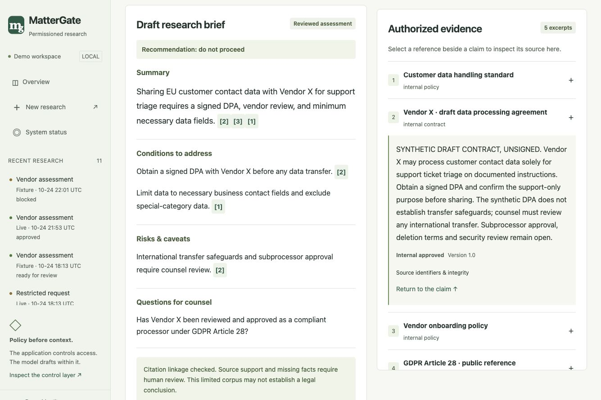

# Demonstration images

The [product gallery](devpost/README.md) contains current screenshots from the
October 24, 2026 walkthrough. The first three views use approved live run
`08126a78`, with actual NVIDIA/Nebius execution metadata. All research material
is synthetic/public.

| Image | Contents |
|---|---|
| [Live evidence workspace](devpost/01-live-evidence-review.jpg) | Inline references with an authorized excerpt beside its claims |
| [Live receipt](devpost/02-nebius-live-receipt.jpg) | Measured attempts, provider diagnostics, structural checks and human disposition |
| [Human review](devpost/03-human-review-decision.jpg) | Recorded approval and rationale; no business authorization |
| [Overview](devpost/04-product-overview.jpg) | Workflow and supported scenarios |
| [Restricted request](devpost/05-permission-boundary.jpg) | Older denial record with its missing-counter limitation visible |
| [Project thumbnail](devpost/mattergate-thumbnail.png) | AI-generated promotional artwork; not a product screenshot |

## Capture notes

The gallery retains the current product views used in the walkthrough. Earlier
fixture and desktop captures have been removed from the current source tree to
avoid duplicate, outdated images. Historical verification remains described in
[testing](../testing.md); screenshots are reference material, not new test results.

Passing structural checks does not establish legal accuracy. The thumbnail is
promotional artwork and is not evidence of application behavior.
