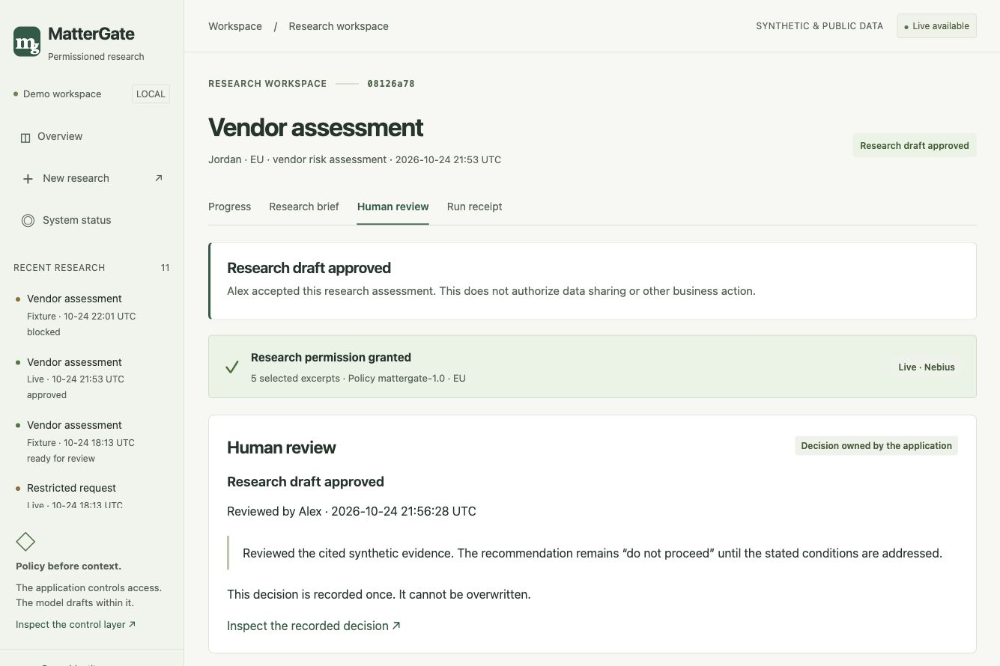
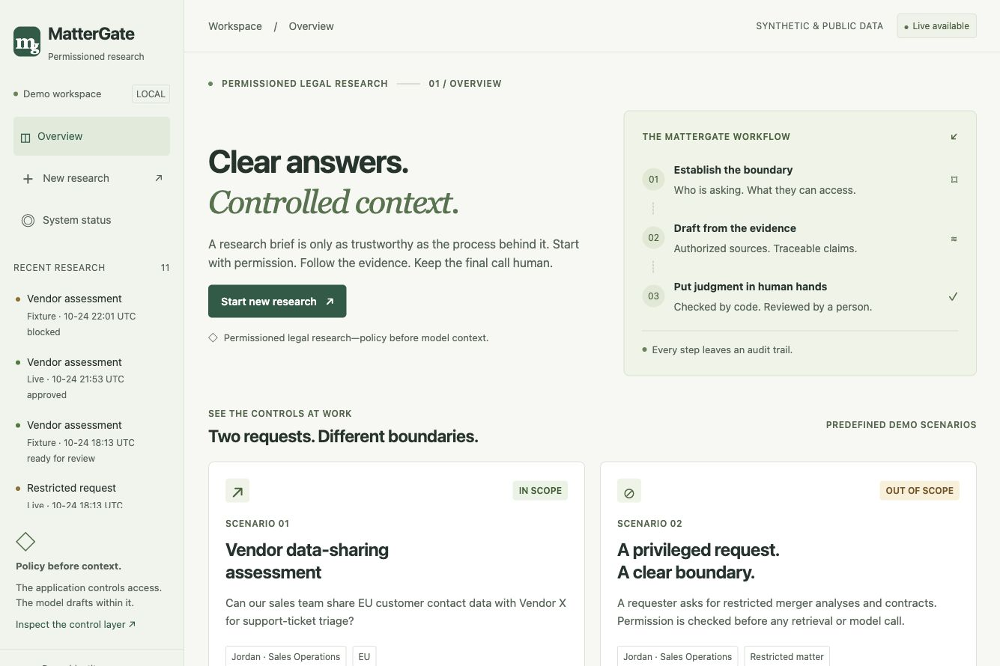
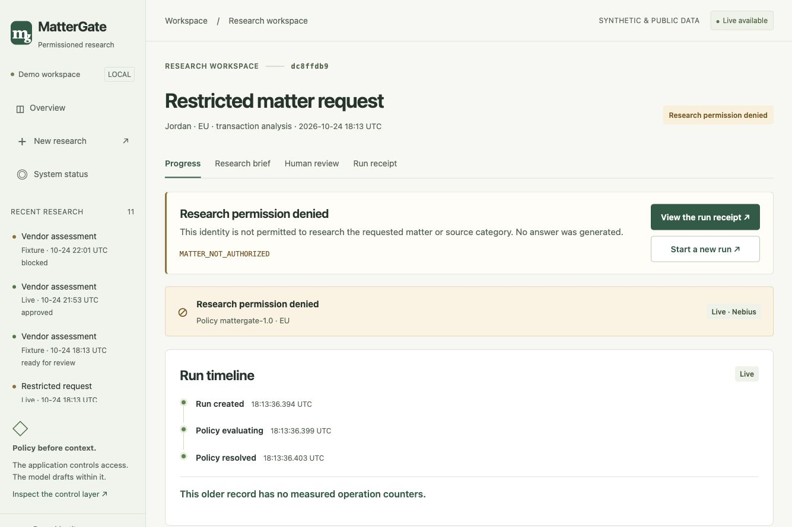

# Product gallery

Captured from MatterGate on October 24, 2026. The five product screenshots are
native browser captures without browser/OS chrome or altered application content.
Each JPG is 1335 × 890 (3:2) and below 5 MB.

## Live evidence review

A live NVIDIA/Nebius research brief with inline references and an expanded
authorized excerpt. Citation linkage is structural; source support requires review.

## Live run receipt

Actual metadata from one observed run, including model, HTTP result, token usage,
attempts and human disposition. These values are not a performance benchmark.

## Human review

Approval accepts the research assessment. It does not authorize data sharing.

## Overview

Permission before context, evidence-based drafting and separate human review.

## Permission boundary

An older restricted request stopped before retrieval/inference. It predates
measured counters; that limitation remains visible.

The first three screenshots show approved live run `08126a78`. All research
materials are synthetic/public. Capturing the views made no new model call and
changed no research records.

## Project artwork

AI-generated promotional artwork, distinct from the product screenshots.
PNG, 1536 × 1024 (3:2), approximately 2 MB.
